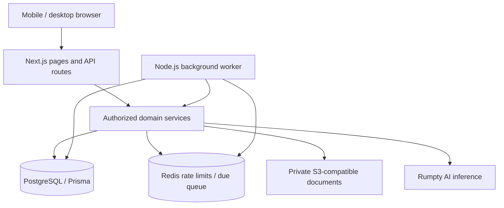

# Treviqo Architecture

## Current implementation

Next.js App Router hosts React pages and Node.js route handlers in one strict-TypeScript modular monolith. A separately deployed Node.js worker imports the same domain services. PostgreSQL is the source of truth; no employer, bank, PFA or insurer integration is required. Runtime infrastructure is hosted on RumptyCloud.

| Boundary                         | Implemented responsibility                                                                | Source                                                                           |
| -------------------------------- | ----------------------------------------------------------------------------------------- | -------------------------------------------------------------------------------- |
| Web/API                          | Rendering, request validation, session checks and response transport                      | `src/app/`, `src/components/`                                                    |
| Authentication/profile/account   | Argon2id credentials, revocable sessions, personal profile and seven-day account deletion | `src/modules/auth/`, `profile/`, `account/` under `src/modules/`                 |
| Employment/documents/extractions | Owned records, private originals, proposed/reviewed fields and revision history           | `src/modules/employments/`, `documents/`, `extractions/` under `src/modules/`    |
| Exit/finance/Passport/reminders  | Deterministic decisions and owner/employment-scoped evidence reuse                        | `src/modules/exits/`, `finance/`, `passport/`, `reminders/` under `src/modules/` |
| Infrastructure                   | Validated runtime environment, Prisma, Redis, S3 and AI adapters                          | `src/server/`                                                                    |
| Worker                           | Continuous loop, health endpoint, durable job dispatch                                    | `src/worker/`, `src/server/jobs/`                                                |

### Data and ownership

See [the Prisma schema](../../prisma/schema.prisma). Employer name is stored on Employment; there is no independent Employer table. Passport entries and checklist results are derived, not stored as PassportEntry/ExitChecklistItem tables. Persistent records include User, AuthSession, Employment, EmploymentDocument, DocumentExtraction, ExtractedField, ExtractionFieldRevision, ExitCase, SettlementItem, PensionVerification, Benefit, Reminder, BackgroundJob and AuditEvent.

Every server operation checks the authenticated user and relevant employment. Composite ownership foreign keys reinforce those boundaries. A user's documents from another employment cannot satisfy this employment's evidence checks. Private storage keys are not public document URLs. Signed downloads are short-lived bearer links issued only after authorization/audit.

Mutations use atomic writes/audits and appropriate row locks/version checks. Exit, finance, Passport and reminder display reads use owner-filtered queries; they are not guaranteed to be one cross-query snapshot. Mutations recheck current evidence/version under their transaction. Source changes invalidate derived confirmation rather than silently copying old values.

### Background work

PostgreSQL BackgroundJob rows hold durable due times, cursors, attempts and two-minute leases. Redis stores fixed job IDs in a due sorted set and a heartbeat; lost queue state is reconstructed from PostgreSQL. Database locks/leases provide ownership fencing, not Redis application locks. Redis also enforces request rate limits and is not the domain datastore or a general document cache.

Four recurring jobs are defined in [queue.ts](../../src/server/jobs/queue.ts):

- `reminders`: reconcile unresolved exit actions and pension follow-ups in transactions of at most three reminder actions, with at most five transactions per tick. Completed-case cursors commit with the last reminder batch; partial cases resume from their idempotent persisted reminder state.
- `session_cleanup`: remove expired sessions in batches of 500; access checks already enforce expiry.
- `account_cleanup`: process due scheduled account deletion with verified object checkpoints and per-account backoff.
- `extraction_cleanup`: fail expired extraction attempts in bounded batches of 20.

Deployment health measures dependency availability and recent local loop progress; strict job health separately reports retry counts and overdue/stale sweeps. The loop waits 10 seconds between ticks; completed sweeps become due after 60 seconds. Redis loss, lease expiry and retries are recoverable. There is no background inference queue: extraction runs in the request flow outside database transactions. The worker does not infer legal/benefit decisions, send external notifications or clean arbitrary pending documents for active accounts.

### Evidence and provider boundaries

Original documents remain in private S3 storage. PostgreSQL stores metadata, reviews and selected excerpts. Local bounded PDF text preparation feeds Rumpty inference; narrow source-label recovery and manual entry retain proposed/unreviewed status. Reviewed facts feed deterministic rules; no model decides legal entitlement or benefit portability. See [AI contract](../ai/AI_DOCUMENTS.md#current-implementation).

Account deletion schedules cleanup seven days ahead and disables normal access immediately. A pending document is finalized only after verifiable object absence. The operator reported two successful direct S3 document deletions on 22 October 2026; see [current operational evidence and limits](../deployment/RUMPTY_DEPLOYMENT.md#current-deployment-and-known-limitation). Failures still preserve pending metadata and worker checkpoints.

### Deployment and future clients

Web, worker and migration images are explicit Docker targets; web remains the default. Each deployed process has separate runtime environment configuration. Matching source code does not guarantee matching credentials or permissions. See [deployment](../deployment/RUMPTY_DEPLOYMENT.md) for health, backups and release operations.

Native mobile is future work. Shared TypeScript domain boundaries and APIs support that direction, but no native client or mobile-auth compatibility guarantee is delivered.

## Historical implementation detail

The milestone sections below preserve earlier architectural decisions and validation context. Their absent-feature statements and earlier read/persistence descriptions are superseded by the current implementation above.

## Milestone 0 implementation

One Next.js App Router process hosts React pages and Node.js route handlers. `src/app` is transport/presentation; `src/modules` owns feature boundaries; `src/server` holds server-only provider adapters. No worker or separate API deployment is needed yet.

PostgreSQL uses Prisma 6 with committed SQL migrations. `User.id` is the stable, provider-independent identity. Credentials registration persists a normalized unique email and Argon2id password hash. Legacy issuer/subject fields are nullable and preserved by an additive migration; there is no active OIDC dependency. Future providers can link identities to the existing internal user ID without changing domain ownership. Do not automatically link an unverified email to another identity.

Authentication is application-managed credentials authentication hosted with Treviqo on Rumpty Cloud, backed by Treviqo PostgreSQL. NextAuth 4 retains credentials handling, CSRF protection, encrypted HttpOnly session cookies, and safe redirects. `src/modules/auth/credentials.ts` isolates registration/login from transport and `session-store.ts` manages revocation. The encrypted cookie holds internal user/session IDs; public session responses expose only user ID and expiry. Every session lookup checks `AuthSession` ownership and an absolute eight-hour database expiry. Logout deletes the current session, invalidating replayed copies. Database outages fail closed; failed revocation is reported instead of claiming logout succeeded. Rotate `SESSION_SECRET` to invalidate all cookies.

Rumpty PostgreSQL, Redis 8.1, S3-compatible storage, AI inference, and app deployment/compute are confirmed available. A managed OIDC/identity service is not assumed or required.

The S3 SDK is used only as a protocol client against a mandatory configured Rumpty endpoint with explicit credentials. It introduces no AWS hosting dependency. The original connectivity contract is now extended by Milestone 2 private upload, deletion, and signed download operations. Redis supplies a bounded connection and a global auth request limiter. Neither infrastructure client is initialized during module import.

Production environment is validated when an integration is used, allowing builds without deployment secrets. Missing integrations fail closed at the auth boundary and return unavailable readiness. Liveness remains independent of external services. The storage and database remain the persistent-state boundaries; the web filesystem is disposable.

## Milestone 1 employment records

`src/modules/employments` owns shared input validation, date formatting/history grouping, and server-only persistence. Next.js pages and API routes use that module; auth/session and infrastructure adapters remain unchanged. There are no new dependencies or services.

`Employment` belongs to `User` through a foreign key. It records employer name, role title, start/end dates (`DATE`), nullable employment type, status, and timestamps. Database enums limit statuses/types; an owner/status/start-date index supports personal history. The additive migration does not alter authentication rows.

Transport: `GET/POST /api/employments` and `GET/PUT /api/employments/:id`. PUT replaces the editable fields. Authentication is checked per request, JSON/Origin/body size are validated for writes, and every read/write is owner-scoped. A write uses both record ID and owner in its predicate. Strict input validation rejects client-supplied IDs, owners, or timestamps. Responses return record fields only and disable caching; missing and foreign IDs both yield 404.

Pages: Home groups current/previous employment; `/employments/new`, `/employments/:id`, and `/employments/:id/edit` provide creation, viewing, and editing. Each page checks authentication before fetching data. Employment routes keep Home selected in the unchanged five-section navigation. Server-rendered loading/error boundaries and client save/error states cover unavailable services without exposing provider errors. Multiple records and concurrent jobs are permitted; edits currently use last-save-wins semantics. No deletion endpoint is introduced.

## Milestone 2 document vault

`src/modules/documents` owns validation, whitelisted DTOs, ownership, and upload/access/delete orchestration. Pages and `/api/documents` call the same services. `PrivateObjectStorage` is injected for tests; production uses the existing explicit-endpoint S3 SDK adapter. PostgreSQL holds metadata and audit events; objects never depend on the app filesystem. No worker or AI pipeline is introduced.

Uploads use a bounded binary request, employment/category query parameters, and an encoded `x-file-name` header. Authentication and employment ownership precede reading bytes. The service reserves metadata, uploads privately, then atomically marks Ready and records the upload audit. A durable reservation retains the key after partial failures. Only Ready documents can receive signed access. Deletion first marks Deleting, removes the object, then atomically records Deleted and its audit. Retry handles missing objects. See the [vault report](../archive/milestones/DOCUMENT_VAULT.md) for crash recovery and retention.

The additive migration creates document/category/status/audit enums and tables, indexed ownership relations, and a composite employment-owner foreign key. Existing auth data is preserved. Explicit document ownership is checked in addition to employment ownership. APIs expose safe metadata only; storage keys/checksums/owner IDs are not document DTO fields. Signed URLs necessarily contain an object path but are short-lived bearer credentials, never persistent public URLs.

## Milestone 3 document intelligence

`src/modules/extractions` owns type-specific schemas/prompts, bounded orchestration, field review and history. `src/server/ai` owns the explicit Rumpty HTTP adapter and isolated local PDF text preparation. The existing S3 abstraction adds bounded server-side reads; bytes never require public URLs. A targeted `unpdf` dependency performs local parsing; Next standalone tracing includes it and the parser subprocess script.

`DocumentExtraction` belongs to the document and explicit owner via a composite foreign key. `ExtractedField` stores immutable original proposal/evidence, confidence, reviewed value/state, and version. `ExtractionFieldRevision` records successive owner reviews. API transport is `GET/POST/PATCH /api/documents/:id/extractions`; `/documents/:id/review` is the mobile review screen. The existing monolith/auth/Redis/storage patterns remain intact; no microservice, queue, OCR, or rules engine is introduced.

Inference is outside database transactions. Short transactions lock the source document when reserving/finalizing/reviewing attempts, serializing against deletion. Deleting a document purges all extracted fields/revisions/attempts in the final deletion transaction, while content-free audit events remain. A late result cannot recreate deleted data. Earlier attempts are retained on retry; the UI shows the latest 20 attempts and the latest 20 revisions per field. Fields never become trusted solely because of confidence or a retry.

## Milestone 4 Job Exit Checker

`src/modules/exits` owns shared input schemas, pure `buildChecklist` rules, an owner-scoped Prisma service, and HTTP transport. `ExitCase` stores typed dates/answer enums, selected evidence IDs, reviewed notice field version, timestamps, and optimistic version. User and composite employment-owner foreign keys enforce ownership. A unique employment ID permits one editable case per employment. No new provider, dependency, worker, or environment configuration is introduced.

`GET/POST /api/exits`, `GET/PUT /api/exits/:id`, and `GET /api/exits/evidence?employmentId=...` independently authorize the worker. Documents and reviewed fields must belong to that same worker and employment. Service reads compute nine checklist items under a repeatable-read transaction from current answers/evidence; checklist states are not persisted or client-settable. Evidence IDs are non-authorizing references, deliberately retained after source deletion so the next read can explain missing/changed evidence. No extracted value or filename is copied into case metadata when selecting a reviewed source.

Create/update writes and content-free audit events commit together. AuditEvent now permits a null documentId and an exitCaseId for exit actions, retaining existing audit data. Updates require a matching case version and cannot reassign employment/ownership. Cases do not mutate employment status/end dates. The mobile Exit area provides employment selection, four steps, save-and-return, detail/checklist, editing, loading/error/not-found states. Home links to actual saved cases. Milestone 4 does not add persisted checklist history or case closure/archive. Milestone 5 adds the finance service below.

## Milestone 5 finance module

`src/modules/finance` extends the modular monolith with pure versioned comparison/matching rules, strict transport schemas, transactional owner-scoped services, and an employment-closure lifecycle hook. SettlementItem and PensionVerification reference ExitCase through composite ownership foreign keys. Financial values remain in reviewed extraction evidence rather than duplicated finance snapshots. Reads recompute against current reviewed sources; confirmation hashes bind evidence and employment/exit context. Writes use serializable transactions, exit-row locking, optimistic versions, and atomic audits.

`/exit/[id]/finance` and `/api/exits/[id]/finance` reuse document uploads/reviews, auth, private storage, and the AI adapter. No new service/provider/dependency, background scheduler, or Passport is introduced. See [implementation details](../archive/milestones/SETTLEMENT_PENSION.md).

## Milestone 6 Passport

`src/modules/passport` derives Passport entries from owned closed employments without a duplicated PassportEntry table. Entry IDs are employment IDs. The timeline/detail APIs and mobile pages reuse original facts and the existing exit/finance services inside one repeatable-read snapshot; shared transaction entry points retain their own ownership checks.

Benefit persists only new worker portability assessments, source document/field/version references, context hash and optimistic version, unique per employment/category. Composite ownership relations and atomic content-free audits apply. Serializable writes lock employment and reject stale contexts/versions. Closing/reopening needs no Passport generation job: visibility derives from current status, and source/context edits invalidate assessments on read. See [Milestone 6 report](../archive/milestones/BENEFIT_PASSPORT.md).

## Milestone 7 implementation

The Milestone 7 worker extends this monolith with PostgreSQL durable job/cursor/lease state and a repairable Redis due queue. It invokes the existing exit/finance services to reconcile owned reminders and cleans expired sessions. No microservice API or external notification provider is added. See [Milestone 7](../archive/milestones/REMINDERS_RELIABILITY_SECURITY.md). Earlier milestone descriptions of absent workers/automation describe their historical scope.

## Scheduled account lifecycle

Account deletion now uses the existing background-job outbox/Redis worker, not
browser-driven permanent cleanup. User schedule/start timestamps define active,
pending and deleting states; per-account retry metadata and document checkpoints
support bounded cleanup. Auth session creation, scheduling and cancellation use the User lock, as does
upload reservation. Storage PUT runs outside that database lock; the durable
reservation and upload grace period protect cleanup. The credentials provider can return a
verified pending/processing state without creating a session; cancellation requires
fresh credentials and creates a fresh session afterward. See
[account lifecycle details](../security/ACCOUNT_DELETION.md).
